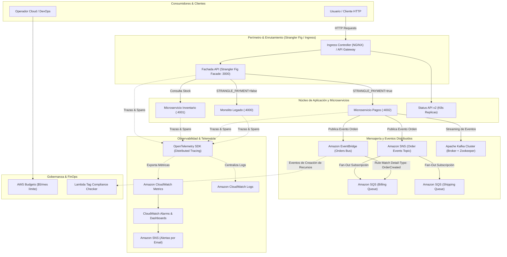
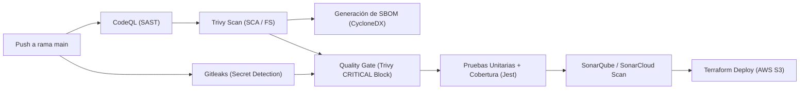
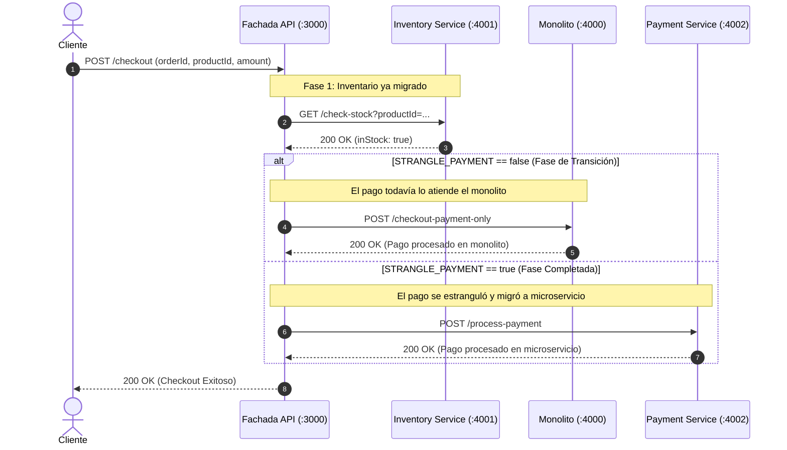

# DevSecOps Pipeline & Cloud Modernization Lab
### Proyecto Integrador de Nube II — ESEN

Repositorio integral que consolida las prácticas de ingeniería de software moderna en la nube: **DevSecOps end-to-end**, **Infraestructura como Código (IaC)**, **Arquitectura Orientada a Eventos y Mensajería**, **Contenerización y Orquestación con Kubernetes y Helm**, **Modernización de Monolito a Microservicios con el Patrón Strangler Fig**, **Observabilidad Distribuida (OpenTelemetry + CloudWatch)** y **Gobierno Financiero y de Recursos (FinOps)**.

---

## Tabla de Contenidos

1. [Resumen Ejecutivo](#-resumen-ejecutivo)
2. [Arquitectura del Sistema](#-arquitectura-del-sistema)
   - [Arquitectura Global de la Solución](#arquitectura-global-de-la-solución)
   - [Pipeline DevSecOps (Shift-Left Security)](#pipeline-devsecops-shift-left-security)
   - [Patrón Strangler Fig (Modernización del Monolito)](#patrón-strangler-fig-modernización-del-monolito)
3. [Estructura del Proyecto](#-estructura-del-proyecto)
4. [Tecnologías y Herramientas Utilizadas](#-tecnologías-y-herramientas-utilizadas)
5. [Módulos y Componentes Detallados](#-módulos-y-componentes-detallados)
   - [1. DevSecOps & CI/CD](#1-devsecops--cicd)
   - [2. Infraestructura como Código (IaC) Modular y Multiambiente](#2-infraestructura-como-código-iac-modular-y-multiambiente)
   - [3. Observabilidad, Monitoreo y Alertamiento](#3-observabilidad-monitoreo-y-alertamiento)
   - [4. Integración Empresarial, Mensajería y Eventos](#4-integración-empresarial-mensajería-y-eventos)
   - [5. Contenedores, Kubernetes y Helm](#5-contenedores-kubernetes-y-helm)
   - [6. FinOps y Gobernanza Cloud](#6-finops-y-gobernanza-cloud)
   - [7. Modernización Monolítica (Strangler Fig)](#7-modernización-monolítica-strangler-fig)
6. [Guía de Inicio](#-guía-de-puesta-en-marcha)

---

##  Resumen Ejecutivo

Este proyecto demuestra la implementación integral de un ciclo de vida de desarrollo de software seguro y moderno (DevSecOps) junto con la transformación arquitectónica de una aplicación empresarial. Los pilares clave incluyen:

- **Seguridad Desplazada a la Izquierda (Shift-Left Security):** Análisis estático (SAST con CodeQL), detección proactiva de secretos expuestos (Gitleaks), análisis de composición de software y vulnerabilidades de dependencias (SCA con Trivy), generación de inventario formal de software (SBOM CycloneDX) y barreras de calidad (Quality Gates con SonarCloud/SonarQube y Trivy).
- **Infraestructura como Código (IaC) Robusta:** Diseñada con Terraform siguiendo principios modulares y DRY, backend remoto seguro en Amazon S3 con bloqueo concurrente en DynamoDB, y separación de ambientes (`dev`).
- **Arquitectura de Microservicios Desacoplada:** Migración incremental desde un sistema monolítico hacia servicios independientes de inventario y pagos utilizando el patrón Strangler Fig (Fachada de API).
- **Procesamiento de Eventos y Mensajería Asíncrona:** Patrones de distribución Fan-Out (Amazon SNS + SQS), enrutamiento reactivo basado en eventos (Amazon EventBridge) y streaming de alto rendimiento (Apache Kafka).
- **Contenerización y Orquestación:** Empaquetado optimizado mediante Dockerfiles multi-etapa minimizados y despliegues en Kubernetes gestionados mediante Helm Charts, con escalado horizontal automático (HPA), Ingress NGINX y presupuestos de disrupción de Pods (PDB).
- **Observabilidad Integral:** Trazabilidad distribuida con OpenTelemetry, métricas personalizadas y logs centralizados en Amazon CloudWatch, alarmas e infraestructura de alertamiento vía Amazon SNS.
- **FinOps y Gobierno:** Auditoría y análisis de costos en Python, creación de presupuestos con AWS Budgets y validación automática de directivas de etiquetado (Tagging Governance) mediante AWS Lambda.

---

##  Arquitectura del Sistema

### Arquitectura Global de la Solución



---

### Pipeline DevSecOps (Shift-Left Security)

El flujo de integración y despliegue continuo implementado en `.github/workflows/deploy.yml` garantiza que ningún cambio llegue a infraestructura sin antes superar 5 capas estrictas de seguridad y calidad:



1. **SAST (Static Application Security Testing):** GitHub CodeQL analiza el código fuente JavaScript en búsqueda de vulnerabilidades y malas prácticas.
2. **Detección de Secretos:** Gitleaks inspecciona el historial de commits y cambios en busca de claves de API, tokens o credenciales expuestas accidentalmente.
3. **SCA (Software Composition Analysis):** Aqua Security Trivy escanea dependencias y librerías en busca de CVEs conocidos.
4. **SBOM (Software Bill of Materials):** Anchore genera el manifiesto formal de componentes de software en formato estándar `CycloneDX JSON`.
5. **Security Quality Gate:** Política bloqueante que falla el pipeline si Trivy detecta vulnerabilidades de severidad `CRITICAL`.
6. **Análisis de Calidad de Código:** Ejecución de pruebas unitarias con Jest generando reporte LCOV, seguido del análisis de calidad, cobertura y mantenibilidad con SonarCloud/SonarQube.
7. **Despliegue Continuo (IaC):** Si todos los checks anteriores son satisfactorios, Terraform aprovisiona o actualiza el bucket S3 y despliega el sitio web estático.

---

### Patrón Strangler Fig (Modernización del Monolito)

El patrón **Strangler Fig** permite migrar gradualmente funcionalidades del monolito hacia microservicios modernos sin requerir una reescritura masiva de alto riesgo (*big bang*):



---

##  Estructura del Proyecto

A continuación se detalla la organización de los directorios y archivos principales del repositorio:

```plaintext
devsecops-pipeline-lab/
├── .github/
│   └── workflows/
│       └── deploy.yml              # Pipeline DevSecOps completo en GitHub Actions
├── api-gateway/                    # Terraform para API Gateway y SNS Fan-out
│   ├── main.tf                     # Configuración de HTTP/REST API Gateway
│   ├── fanout.tf                   # Tópico SNS y suscripciones a colas SQS
│   ├── variables.tf / outputs.tf
│   └── *.zip                       # Paquetes de funciones Lambda
├── backend-bootstrap/              # Terraform para creación de S3 y DynamoDB para Remote State
│   ├── main.tf
│   └── variables.tf
├── environments/                   # Despliegue de infraestructura segregada por ambientes
│   └── dev/                        # Entorno de desarrollo con backend remoto configurado
│       ├── main.tf
│       ├── variables.tf
│       └── outputs.tf
├── events/                         # Arquitectura EDA con Amazon EventBridge
│   ├── main.tf                     # Event Bus, reglas de filtrado y destinos SQS
│   ├── variables.tf
│   └── outputs.tf
├── facade/                         # Fachada de API (Patrón Strangler Fig)
│   ├── app.js                      # Proxy inteligente que desvía tráfico entre Monolito y Microservicios
│   ├── tracing.js                  # Instrumentación OpenTelemetry
│   └── package.json
├── finops/                         # Análisis financiero de la nube
│   ├── analyze_costs.py            # Script en Python para análisis de costes de AWS
│   └── aws-cost-sample.csv         # Datos muestrales de facturación mensual de AWS
├── finops-budget/                  # Gobierno de costos con AWS Budgets
│   ├── main.tf                     # Presupuesto mensual de $5 USD y alertas por umbral
│   └── variables.tf
├── governance/                     # Directivas de etiquetado y cumplimiento
│   ├── main.tf                     # Infraestructura Terraform para chequeo de políticas
│   ├── variables.tf
│   └── tag-compliance-checker.zip
├── infra/                          # Infraestructura base para sitio web estático
│   ├── main.tf                     # Bucket S3, bucket policy y website configuration
│   ├── variables.tf / outputs.tf
│   └── website/                    # Código HTML de la aplicación web
│       └── index.html
├── inventory-service/              # Microservicio independiente de inventario
│   ├── app.js                      # Endpoint /check-stock con instrumentación de trazabilidad
│   ├── tracing.js
│   └── package.json
├── k8s/                            # Manifiestos de Kubernetes
│   ├── kind-cluster-config.yaml    # Configuración de clúster local Kind con mapeo de puertos
│   ├── status-api-deployment.yaml  # Deployment de Status API v2
│   ├── status-api-ingress.yaml     # Reglas de Ingress NGINX
│   ├── status-api-hpa.yaml         # Horizontal Pod Autoscaler (HPA)
│   ├── status-api-pdb.yaml         # PodDisruptionBudget (PDB)
│   ├── kafka-deployment.yaml       # Despliegue de Kafka dentro de Kubernetes
│   ├── consumer-deployment.yaml    # Deployment del consumidor Kafka
│   └── producer-job.yaml           # Job de Kubernetes para producir eventos Kafka
├── k8s-app/                        # Lab 15: Aplicación y consumidor Kafka para Kubernetes
│   ├── Dockerfile
│   ├── kafka-consumer.js
│   ├── kafka-producer.js
│   └── package.json
├── kafka-local/                    # Entorno local de Apache Kafka
│   └── docker-compose.yml          # Zookeeper y Broker Kafka para pruebas locales
├── lambda/                         # Funciones Serverless para API Gateway
│   ├── create-order.js
│   └── health.js
├── lambda-governance/              # Función Lambda de verificación de Tags
│   └── tag-compliance-checker.js
├── modules/                        # Módulos reutilizables de Terraform
│   └── static-site/                # Módulo para provisión de S3 Static Website
│       ├── main.tf
│       ├── variables.tf
│       ├── outputs.tf
│       └── README.md
├── monolith/                       # Aplicación Monolítica original
│   ├── app.js                      # Endpoints legados de checkout, inventario y pago
│   ├── tracing.js
│   └── package.json
├── observability/                  # Monitoreo, Dashboards y Alarmas
│   ├── main.tf                     # Log Group de CloudWatch y permisos IAM
│   ├── alarms.tf                   # Alarmas de métricas para conteo de errores y latencia
│   ├── alerting.tf                 # Tópico SNS y suscripciones de correo electrónico
│   ├── dashboard.tf                # Tablero visual interactivo de CloudWatch
│   ├── trigger-alert-test.js       # Script de prueba para inyectar fallos y disparar alarmas
│   └── variables.tf / outputs.tf
├── payment-service/                # Microservicio independiente de procesamiento de pagos
│   ├── app.js                      # Endpoint /process-payment desacoplado
│   ├── tracing.js
│   └── package.json
├── src/                            # Lógica de negocio y patrones distribuidos
│   ├── orderService.js             # Lógica de órdenes con OpenTelemetry spans
│   ├── inventoryService.js         # Simulación de verificación de stock
│   ├── paymentService.js           # Simulación de procesamiento de pagos
│   └── utils.js                    # Funciones utilitarias validadas por pruebas unitarias
├── status-api/                     # API optimizada en contenedores
│   ├── Dockerfile                  # Dockerfile Multi-Stage optimizado (Alpine + non-root)
│   ├── server.js                   # Servidor Express con endpoints /health y /
│   └── package.json
├── status-api-chart/               # Helm Chart de Kubernetes
│   ├── Chart.yaml                  # Metadatos del Chart
│   ├── values.yaml                 # Valores para desarrollo / base
│   └── values-prod.yaml            # Valores optimizados para producción (HPA, PDB)
│   └── templates/                  # Plantillas de Deployment, Service, Ingress, HPA, PDB
├── tests/                          # Pruebas unitarias
│   └── utils.test.js               # Suite de pruebas Jest con cobertura de código
├── kafka-consumer.js               # Script consumidor de Kafka en Node.js
├── kafka-producer.js               # Script productor de eventos Kafka en Node.js
├── poll-inventory.js               # Polling de mensajes SQS de inventario
├── poll-notifications.js           # Polling de mensajes SQS de notificaciones
├── publish-order-event.js          # Publicador de eventos en Amazon EventBridge
├── run-observed-checkout.js        # Ejecutor de checkout con telemetría CloudWatch + OTel
├── sns-fanout-consumer.js          # Consumidor de colas SQS provenientes de SNS Fan-out
├── sonar-project.properties        # Configuración del escáner SonarQube / SonarCloud
├── tracing.js                      # Inicialización del SDK Node de OpenTelemetry
├── get_helm.sh                     # Script utilitario de instalación de Helm
├── pedido.json                     # Payload de prueba para el flujo de checkout
└── package.json                    # Dependencias globales del proyecto
```

---

## Tecnologías y Herramientas Utilizadas

### DevSecOps, Seguridad y Calidad de Código
- **GitHub Actions:** Orquestador de integración y despliegue continuo (CI/CD).
- **GitHub CodeQL:** Análisis estático de seguridad de código fuente (SAST).
- **Gitleaks:** Detección automática de fuga de credenciales y secretos en el código.
- **Aqua Security Trivy:** Escaneo de vulnerabilidades del sistema de archivos y librerías (SCA).
- **Anchore Syft (sbom-action):** Generación de listas de materiales de software (SBOM en estándar CycloneDX).
- **SonarQube / SonarCloud:** Inspección continua de calidad, deuda técnica, *code smells* y cobertura.
- **Jest:** Framework de pruebas unitarias en JavaScript con generación de reportes de cobertura LCOV.

### Infraestructura como Código (IaC) & Cloud (AWS)
- **Terraform (v1.5+):** Provisión declarativa de infraestructura en la nube.
- **AWS S3:** Alojamiento de sitios web estáticos y almacenamiento de archivos de estado (tfstate).
- **AWS DynamoDB:** Control de concurrencia y bloqueo de estado (*state locking*) para Terraform.
- **AWS IAM:** Gestión granular de accesos siguiendo el principio de menor privilegio (*least privilege*).
- **AWS Lambda:** Cómputo serverless para API Gateway y gobernanza de cumplimiento.
- **Amazon API Gateway:** Exposición y gestión de endpoints HTTP/REST.

### Mensajería, Eventos y Streaming
- **Amazon SNS:** Servicio de notificaciones y publicación de mensajes bajo el patrón Fan-Out.
- **Amazon SQS:** Colas de mensajes administradas y desacopladas (`billing-queue`, `shipping-queue`, etc.).
- **Amazon EventBridge:** Bus de eventos serverless con reglas de filtrado por patrón de contenido.
- **Apache Kafka & Zookeeper / KRaft:** Plataforma distribuida de streaming de eventos de alto throughput.
- **KafkaJS:** Cliente de Kafka de alto rendimiento para Node.js.

### Contenedores y Orquestación Cloud-Native
- **Docker:** Contenerización optimizada con construcciones multi-etapa (*multi-stage builds*) sobre Alpine Linux y usuario no privilegiado (`appuser`).
- **Kubernetes (Kind):** Orquestación declarativa de contenedores en clústeres locales.
- **Helm 3:** Gestor de paquetes de Kubernetes para parametrización multi-entorno (`values.yaml`, `values-prod.yaml`).
- **Ingress NGINX:** Controlador de tráfico HTTP/HTTPS externo hacia servicios internos.
- **Horizontal Pod Autoscaler (HPA):** Escalado elástico automático de réplicas basado en consumo de CPU.
- **PodDisruptionBudget (PDB):** Garantía de alta disponibilidad ante eventos de mantenimiento del clúster.

### Observabilidad y Monitoreo
- **OpenTelemetry (OTel):** Estándar de observabilidad para instrumentación de trazas distribuidas, spans y propagación de contexto.
- **Amazon CloudWatch:** Repositorio central de métricas de negocio/latencia y logs de aplicación.
- **CloudWatch Alarms & Dashboards:** Detección de anomalías en tiempo real y paneles visuales de rendimiento.

### FinOps & Gobernanza
- **Python 3 & Pandas:** Scripting analítico para procesamiento de reportes de facturación de AWS.
- **AWS Budgets:** Monitoreo y control presupuestario con notificaciones preventivas de umbrales de costo.
- **Tagging Compliance:** Reglas de auditoría automática para verificar directivas de etiquetado en recursos cloud.

---

## Módulos y Componentes Detallados

### 1. DevSecOps & CI/CD
El archivo `.github/workflows/deploy.yml` encapsula el ciclo de vida seguro del código. El flujo incluye:
- Inicialización y análisis semántico de JavaScript con **CodeQL**.
- Inspección profunda de commits con **Gitleaks** para prevenir credenciales quemadas.
- Detección de vulnerabilidades de dependencias con **Trivy**.
- Exportación del artefacto de cumplimiento `sbom.cyclonedx.json` con **Anchore**.
- Un **Security Gate** que aborta la ejecución con código de salida `1` ante cualquier vulnerabilidad crítica no mitigable.
- Ejecución de la suite de pruebas unitarias (`npm test`) y envío del informe de cobertura a **SonarQube / SonarCloud**.
- Despliegue automatizado de la infraestructura mediante `terraform apply` con credenciales de AWS inyectadas de forma segura vía OpenID Connect / GitHub Secrets.

### 2. Infraestructura como Código (IaC) Modular y Multiambiente
- **Módulo `modules/static-site`:** Encapsula la creación del bucket S3, el bloqueo de acceso público restrictivo o selectivo, la política de lectura de bucket y la habilitación del endpoint de sitio web estático.
- **`backend-bootstrap`:** Crea el bucket de almacenamiento de estado `devsecops-lab-tfstate-*` y la tabla DynamoDB `devsecops-lab-tfstate-locks` para permitir trabajo colaborativo concurrente seguro.
- **`environments/dev`:** Consume el módulo base referenciando el backend remoto con cifrado y locking activado.

### 3. Observabilidad, Monitoreo y Alertamiento
- **`tracing.js`:** Inicializa `NodeSDK` de OpenTelemetry configurado con el servicio `checkout-service`, capturando trazas de extremo a extremo.
- **`run-observed-checkout.js`:** Simula transacciones de compra, emitiendo métricas personalizadas a CloudWatch (`RequestCount`, `ErrorCount`, `LatencyMs`) y logs estructurados a `/devsecops-lab/checkout-service`.
- **`observability/`:** Aprovisiona con Terraform las métricas de CloudWatch, las alarmas que se disparan cuando `ErrorCount >= 1` o `LatencyMs > 500ms`, y tableros con gráficos en tiempo real.

### 4. Integración Empresarial, Mensajería y Eventos
- **SNS Fan-out (`api-gateway/fanout.tf`):** Un único evento publicado en `devsecops-lab-order-events-topic` se replica de forma asíncrona e independiente a las colas SQS de facturación (`billing-queue`) y logística (`shipping-queue`).
- **Amazon EventBridge (`events/main.tf`):** Implementa un bus de eventos personalizado (`devsecops-lab-orders-bus`) con reglas que enrutan eventos basados en su tipo (`OrderCreated`), permitiendo arquitectura reactiva desacoplada.
- **Apache Kafka (`kafka-local/` & `k8s/`):** Implementación de mensajería de alta velocidad para streaming de eventos con productores y consumidores en Node.js mediante la librería `kafkajs`.

### 5. Contenedores, Kubernetes y Helm
- **Docker Multi-Stage (`status-api/Dockerfile`):**
  - *Etapa 1 (deps):* Instala las dependencias excluyendo dependencias de desarrollo (`npm install --omit=dev`).
  - *Etapa 2 (runtime):* Utiliza la imagen ligera `node:20-alpine`, copia únicamente `node_modules` y el código de la aplicación, y define un usuario no root (`appuser`) para mitigar escalamiento de privilegios.
- **Helm Chart (`status-api-chart/`):**
  - Parametrización de réplicas, límites de CPU/memoria y configuración de Ingress.
  - Soporte multi-entorno mediante `values.yaml` (valores por defecto) y `values-prod.yaml` (habilita HPA con mínimo 2 y máximo 6 réplicas al 50% de CPU, y PDB con `minAvailable: 1`).

### 6. FinOps y Gobernanza Cloud
- **`finops/analyze_costs.py`:** Script en Python que analiza el archivo de costos `aws-cost-sample.csv`, agrupando el gasto por servicio, identificando anomalías y recomendando optimizaciones de dimensionamiento (*rightsizing*).
- **`finops-budget/main.tf`:** Configura un presupuesto mensual en AWS Budgets de $5 USD con notificaciones automáticas al alcanzar el 80% del gasto real y el 100% del gasto proyectado.
- **`governance/main.tf` & `lambda-governance/`:** Despliega una función AWS Lambda que inspecciona eventos de creación de recursos en AWS para validar que contengan las etiquetas de gobierno obligatorias (`Environment`, `Owner`, `Project`), alertando en caso de incumplimiento.

### 7. Modernización Monolítica (Strangler Fig)
- **`monolith/app.js`:** Contiene la aplicación monolítica legacy que gestionaba checkout, verificación de existencias y cobro en un solo proceso.
- **`facade/app.js`:** Actúa como proxy inverso inteligente que intercepta todas las peticiones a `/checkout`.
  - El inventario siempre es redirigido al nuevo microservicio `inventory-service` (`:4001`).
  - El procesamiento de pago es gobernado mediante la variable de entorno `STRANGLE_PAYMENT`. Si es `false`, redirige al monolito (`:4000`); si es `true`, redirige al microservicio moderno `payment-service` (`:4002`).

---

## Guía de Inicio

### Prerrequisitos
- **Node.js:** Versión 18 o superior.
- **Terraform:** Versión 1.5 o superior.
- **Docker & Docker Compose:** Para contenedores locales y Kafka.
- **Kind & Kubectl & Helm:** Para pruebas del clúster de Kubernetes.
- **AWS CLI:** Configurado con credenciales de prueba.

### 1. Pruebas Unitarias y Cobertura
```bash
# Instalar dependencias globales
npm install

# Ejecutar pruebas unitarias con reporte de cobertura para SonarQube
npm test
```

### 2. Ejecución Local de la Modernización (Strangler Fig)
Para probar la migración del monolito a microservicios:

```bash
# Terminal 1: Iniciar Monolito (:4000)
cd monolith && npm install && node app.js

# Terminal 2: Iniciar Microservicio de Inventario (:4001)
cd inventory-service && npm install && node app.js

# Terminal 3: Iniciar Microservicio de Pagos (:4002)
cd payment-service && npm install && node app.js

# Terminal 4: Iniciar Fachada API con estrangulación activada (:3000)
cd facade && npm install
STRANGLE_PAYMENT=true node app.js

# Terminal 5: Probar el flujo de checkout a través de la fachada
curl -X POST http://localhost:3000/checkout \
  -H "Content-Type: application/json" \
  -d @pedido.json
```

### 3. Ejecución de Kafka Local
```bash
# Iniciar broker de Kafka y Zookeeper
cd kafka-local
docker compose up -d

# En otra terminal, iniciar el consumidor
node kafka-consumer.js

# En otra terminal, emitir eventos de órdenes
node kafka-producer.js
```

### 4. Despliegue en Kubernetes con Helm
```bash
# 1. Crear clúster Kind con mapeo de puertos
kind create cluster --config k8s/kind-cluster-config.yaml --name devsecops-cluster

# 2. Construir imagen de Status API
docker build -t devsecops-lab/status-api:2.0 ./status-api

# 3. Cargar imagen al clúster Kind
kind load docker-image devsecops-lab/status-api:2.0 --name devsecops-cluster

# 4. Desplegar mediante Helm Chart con valores de producción
helm install status-api ./status-api-chart -f ./status-api-chart/values-prod.yaml

# 5. Verificar Pods, HPA y PDB
kubectl get pods
kubectl get hpa
kubectl get pdb
```

### 5. Análisis de Costos FinOps
```bash
cd finops
python3 analyze_costs.py
```

---
